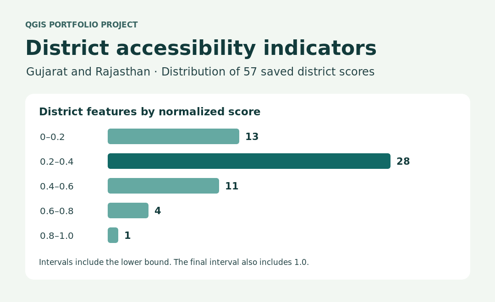

# District accessibility indicators in QGIS

I used QGIS and Python to explore how population density and road and rail
network density vary by district, then summarized the resulting score for
protected areas. The saved district layer contains **57 scored features**
across **Gujarat and Rajasthan**.



## What I worked on

- Prepared district, road, railway, and protected-area layers in **QGIS**.
- Used spatial joins and dissolve steps to organize transport features and
  their lengths by district.
- Worked with population, road, and rail density fields and mapped the saved
  combined score using graduated symbology.
- Used **Python and pandas** to group exported rows by protected-area name
  and compute the mean of the district score values in each group.

## Try the aggregation

Create an environment with Python and install the dependencies from
`requirements.txt`. Then run the original script against the synthetic sample:

```bash
python -m pip install -r requirements.txt
cd examples
python ../scripts/avg.py
```

The script writes `avg_pa.csv`. The expected means are **0.4** for Example Park
and **0.8** for Example Reserve. This is an unweighted mean across the exported
rows.

## Scope and data

The chart uses the saved `Norm_Final` scores from the district output. These
scores are project-specific indicators. The original normalization formula,
weights, and exact QGIS processing settings are unavailable, so the complete
analysis cannot be reproduced from this repository. The chart uses aggregate
counts. The original GIS data and boundary geometry are omitted because the
source boundary license restricts redistribution. The sample CSV is synthetic.
